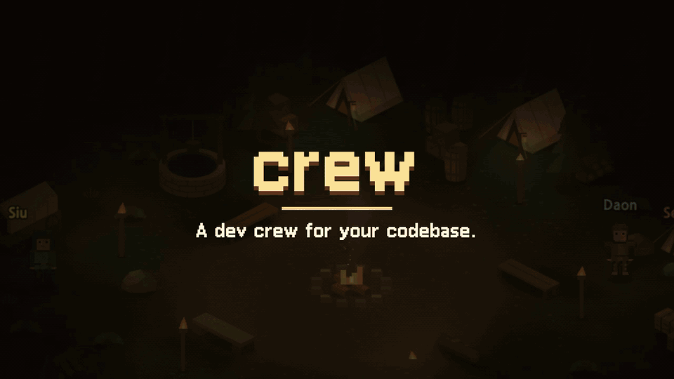

<h1 align="center">crew</h1>

<p align="center"><b>Tell one interpreter what you need. A team of AI agents does the work, and you watch them in a pixel camp.</b></p>

<p align="center">
  
  
  
  
  
</p>

<p align="center"></p>

## Features

- **One chat**: ask in plain words and attach pictures; a conductor assigns the work, and you get a report once review and tests pass
- **Copies on demand**: a member needed twice at once works through a copy that leaves when the task ends
- **Guarded tools**: dangerous commands and writes outside a member's scope are blocked, and anything unusual is asked on a card
- **Your rules**: change each member's nickname, model, tools, skills, and MCP access, and edit the workflow
- **Memory**: what the crew learns goes into a project wiki, and every step leaves a log
- **The camp**: members walk, sit by the fire, and cast spells while they work; click one to open its log
- **Subscription or API**: run on your [Claude Code](https://docs.claude.com/en/docs/claude-code/overview) login or an Anthropic API key, kept encrypted on your computer

## Install

You need Node.js 24+.

```bat
npm install
git config core.hooksPath scripts/hooks
```

The hooks bump the version on each commit.

## Run

```bat
npm start
```

## Build

```bat
npm run package
```

The app lands at `out/crew-win32-x64/crew.exe`.

## Test

```bat
npm test
```
